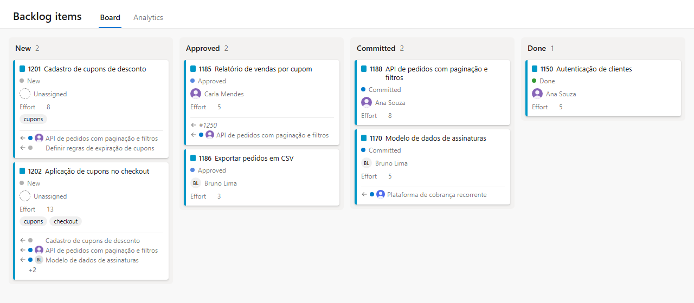
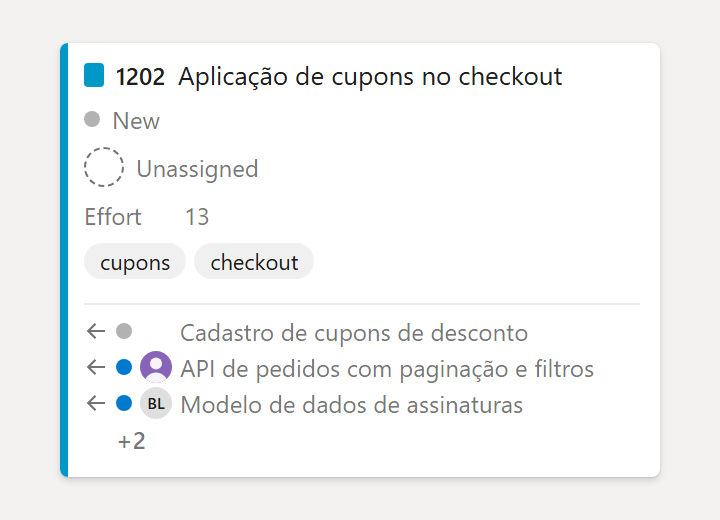
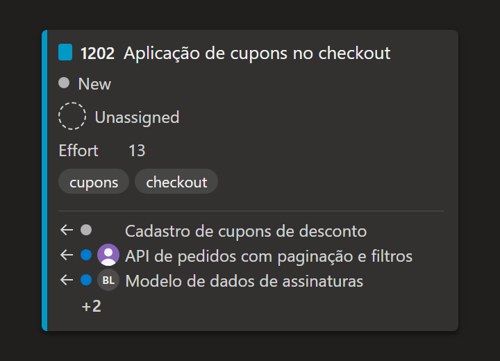
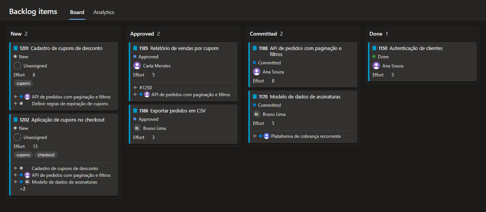
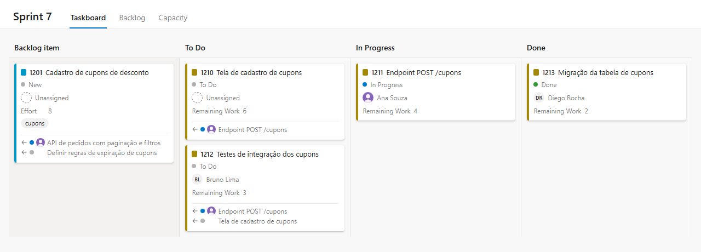
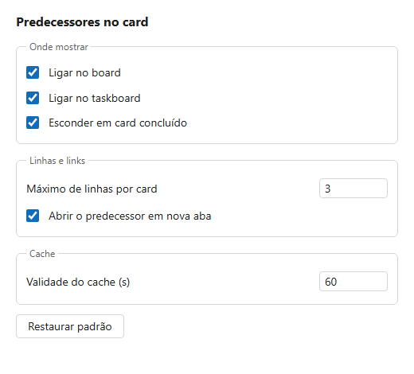
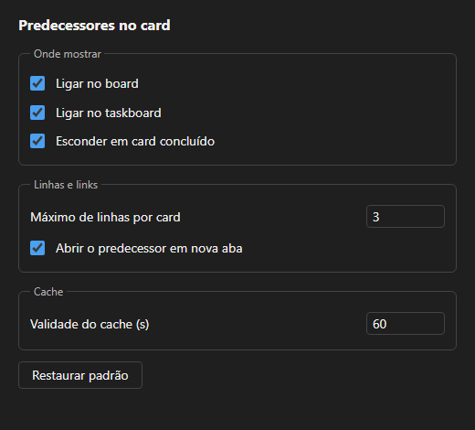
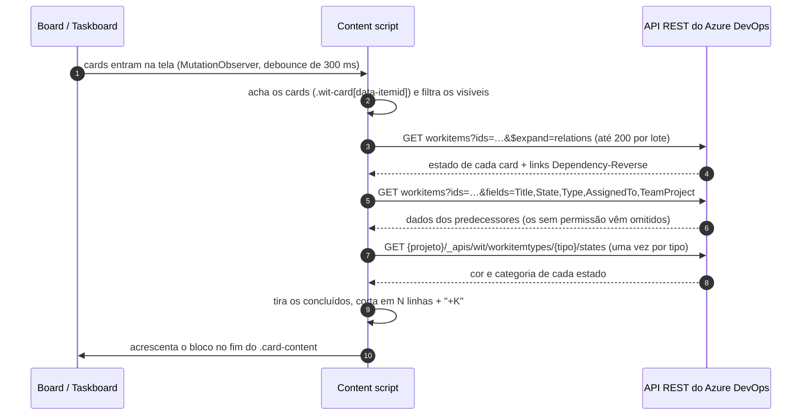

<p align="center">
  
</p>

<h1 align="center">Predecessores no card</h1>

<p align="center">
  Extensão para <strong>Edge</strong> e <strong>Chrome</strong> que mostra, dentro dos cards do
  <strong>Azure Boards</strong>, os predecessores que ainda não foram concluídos.
</p>

<p align="center">
  <a href="LICENSE"></a>
  
  
  
  
</p>

<p align="center">
  
</p>

---

## Sumário

- [Por que existe](#por-que-existe)
- [O que aparece no card](#o-que-aparece-no-card)
- [Exemplos](#exemplos)
- [Recursos](#recursos)
- [Instalação](#instalação)
- [Como usar](#como-usar)
- [Opções](#opções)
- [Quando uma linha aparece (e quando some)](#quando-uma-linha-aparece-e-quando-some)
- [Privacidade e segurança](#privacidade-e-segurança)
- [Compatibilidade](#compatibilidade)
- [Como funciona](#como-funciona)
- [Solução de problemas](#solução-de-problemas)
- [Limitações e próximos passos](#limitações-e-próximos-passos)
- [Desenvolvimento](#desenvolvimento)
- [Contribuindo](#contribuindo)
- [Licença](#licença)

*English summary: a Chromium (Edge/Chrome) Manifest V3 extension that shows, inside Azure Boards
cards (Kanban board and sprint taskboard), the predecessors (`Dependency-Reverse` links) that are not
done yet, with state color, assignee avatar and a clickable title. It reads data from the Azure
DevOps REST API with the user's own session. No data leaves Azure DevOps, and there is no telemetry.*

## Por que existe

No Azure Boards, a dependência entre itens (o link **Predecessor**/**Sucessor**) só aparece quando
você abre o item. No board e no taskboard, onde o time decide o que puxar, não há nenhum sinal de
que um card depende de outro trabalho ainda em aberto. O resultado é gente começando item
bloqueado, ou descobrindo a dependência no meio da sprint.

O Azure DevOps também não oferece ponto de extensão que desenhe conteúdo **dentro** do card: as
extensões do marketplace só aparecem em menus, abas, painéis e no formulário do item. Por isso esta é
uma extensão **de navegador**: ela acrescenta um bloco ao card da própria tela do Azure DevOps.

## O que aparece no card

<p align="center">
  
  &nbsp;
  
</p>

Cada predecessor em aberto vira uma linha no fim do card:

| Elemento | Significado |
| --- | --- |
| **←** | "Este card depende de…" |
| **●** bolinha | Estado do predecessor, **na cor que o processo do time usa** para esse estado. O nome do estado aparece no tooltip ("Estado: Committed"). |
| **Foto** | Responsável pelo predecessor. Sem foto, as **iniciais**; sem responsável, um **espaço vazio** do mesmo tamanho, para as linhas ficarem alinhadas. |
| **Título** | Uma linha só, com reticências. O tooltip mostra `#id Tipo — título completo`. |
| **+K** | Há mais K predecessores em aberto além das linhas visíveis (padrão: 3). O tooltip lista todos. |
| **#id** em itálico | Predecessor que você **não tem permissão** para ler. Aparece só o número, sem link. |

**Clicar** numa linha abre o predecessor numa nova aba. O clique **não** abre o card nem inicia o
arrastar.

## Exemplos

### Board (Kanban)

<p align="center">
  
</p>

O que a imagem mostra:

- **1201**: tem três predecessores, mas um deles (#1190) já está **Done** e não aparece. Ficam o
  #1188, em andamento e com responsável, e o #1195, sem responsável (espaço vazio no lugar da foto).
- **1202**: tem cinco predecessores em aberto. Mostra três linhas e **+2**.
- **1185**: um dos predecessores (#1250) é de uma área que o usuário não pode ler e aparece só como `#1250`.
- **1188**: o único predecessor dele está concluído, então o card fica **sem bloco**.
- **1170**: o predecessor é uma **Feature de outro projeto** ("Plataforma"). A cor vem do processo
  daquele projeto, e o clique abre no projeto certo.
- **1150**: o próprio card está **Done**, então os predecessores dele não aparecem (configurável).

### Taskboard da sprint

<p align="center">
  
</p>

Funciona nas **tasks** e também no **item pai**, na primeira coluna. A task #1211 depende da #1213,
que já está Done, por isso não mostra nada.

> As imagens deste README são geradas por `npm run capturas`. Elas usam o **código real** da
> extensão (busca de dados, filtro, montagem do bloco e CSS) sobre uma reprodução simplificada do
> card: a estrutura vem do HTML real capturado no Azure DevOps, os estilos da página são aproximados
> e os **dados são fictícios**.

## Recursos

- **Board** de qualquer nível (Epics, Features, Backlog items) e **taskboard** da sprint.
- **"Concluído" avaliado pela categoria do estado** (`Completed` ou `Removed`), nunca pelo nome.
  Funciona em Scrum, Agile, CMMI, Basic e processos herdados, em qualquer idioma ("Done", "Closed",
  "Concluído"…).
- **Predecessores de outros projetos** da mesma organização, com a cor do processo de cada projeto.
- **Permissões respeitadas**: o que você não pode ler aparece só como `#id`.
- **Atualização automática**: quando o board recarrega, quando um card muda de coluna (arrastando,
  pelo teclado ou por outra pessoa), quando você rola a tela e quando volta para a aba com o cache
  vencido.
- **Tema claro e escuro**, pelas variáveis de cor do próprio Azure DevOps.
- **Leve**: lotes de até 200 itens por requisição, no máximo 2 requisições simultâneas e cache em memória.
- **Falha em silêncio**: se algo der errado (rede, sessão, mudança na tela), o board continua igual
  ao original.
- **Configurável**: página de opções sincronizada entre os seus navegadores.

## Instalação

### Pela loja (recomendado)

> O link da Chrome Web Store entra aqui assim que a extensão for publicada.

- **Chrome:** abra o link da loja e clique em **Usar no Chrome**.
- **Edge:** abra o mesmo link. Na primeira vez, o Edge mostra a faixa **"Permitir extensões de
  outras lojas"**: clique em **Permitir** e depois em **Obter**.

Pela loja, as atualizações chegam sozinhas.

### A partir do código-fonte

Pré-requisitos: [Node.js](https://nodejs.org/) 20 ou mais novo e Git.

```bash
git clone https://github.com/ivetech-sistemas/ado-boards-predecessor.git
cd ado-boards-predecessor
npm install
npm run build
```

1. Abra `edge://extensions` (ou `chrome://extensions`).
2. Ligue o **Modo de desenvolvedor**.
3. Clique em **Carregar sem compactação** e escolha a pasta **`dist`**.
4. Abra (ou recarregue) um board ou um taskboard do Azure DevOps.

Para atualizar: `git pull`, `npm run build`, **Recarregar** na extensão e recarregar a aba do Azure DevOps.

### Para a empresa toda (TI)

Depois de publicada, a extensão pode ser instalada à força pela política `ExtensionInstallForcelist`
do Edge ou do Chrome:

```
<id-da-extensão>;https://clients2.google.com/service/update2/crx
```

O ID são os 32 caracteres no fim do link da loja.

## Como usar

Não há nada para configurar: abra um **board** ou um **taskboard** e os cards com predecessores em
aberto ganham as linhas.

| Ação | Resultado |
| --- | --- |
| Clique na linha | Abre o predecessor em **nova aba** (ou na mesma aba, se você mudar a opção) |
| Ctrl+clique (⌘+clique no Mac) ou botão do meio | Sempre abre em nova aba |
| Passar o mouse na bolinha | Nome do estado |
| Passar o mouse na foto | Nome do responsável |
| Passar o mouse no título | `#id Tipo — título completo` |
| Passar o mouse no **+K** | Lista dos predecessores que não couberam |
| Tab até a linha + Enter | Abre o predecessor pelo teclado |

## Opções

No menu de extensões do navegador (ícone de quebra-cabeça), clique com o botão direito em
**Predecessores no card** e escolha **Opções**. Ou abra `edge://extensions`, clique em **Detalhes**
e depois em **Opções de extensão**.

<p align="center">
  
  &nbsp;
  
</p>

| Opção | Padrão | O que faz |
| --- | --- | --- |
| Ligar no board | sim | Mostra as linhas no board (Kanban). |
| Ligar no taskboard | sim | Mostra as linhas no taskboard da sprint. |
| Esconder em card concluído | sim | Card em estado concluído não mostra predecessores. |
| Máximo de linhas por card | 3 | Acima disso, aparece "+K". Faixa: 1 a 20. |
| Abrir o predecessor em nova aba | sim | Desligado, o clique abre na mesma aba. |
| Validade do cache (s) | 60 | Por quanto tempo os dados de um item valem antes de serem buscados de novo. Faixa: 5 a 3600. |

As opções ficam em `chrome.storage.sync` (seguem a sua conta do navegador) e valem **na hora** para
as abas já abertas, sem recarregar.

## Quando uma linha aparece (e quando some)

| Situação | O que aparece |
| --- | --- |
| Predecessor em qualquer estado das categorias *Proposed*, *In Progress* ou *Resolved* | Linha completa |
| Predecessor em estado de categoria **Completed** ou **Removed** | Nada (a linha some) |
| Predecessor de outro projeto da mesma organização | Linha completa; o clique abre no projeto dele |
| Predecessor sem responsável | Linha com espaço vazio no lugar da foto |
| Predecessor que você não tem permissão para ler | Só `← #id`, sem link |
| Mais predecessores que o máximo de linhas | As primeiras N linhas e "+K" |
| O próprio card está concluído | Nada (opção "Esconder em card concluído") |
| Card sem predecessores | Nada: o card fica idêntico ao original |
| Sessão do Azure DevOps vencida | Nada, até você entrar de novo |
| Extensão desligada, com erro, ou tela do Azure DevOps mudou | Nada: o board fica idêntico ao original |

Mudou o estado de um predecessor? A linha atualiza quando o cache vence (60 s por padrão) e a tela
é reavaliada: ao rolar, ao voltar para a aba ou ao recarregar o board. Um card movido de coluna é
relido cerca de 2 s depois.

## Privacidade e segurança

- **Nada sai do Azure DevOps.** A extensão não tem servidor, telemetria, analytics nem anúncios.
- **Sem credenciais.** Ela não pede nem guarda PAT, e não lê cookies. As chamadas à API do Azure
  DevOps saem da própria página (mesma origem) e usam a sessão que você já tem aberta, exatamente
  como o Azure DevOps faz.
- **Só lê.** A extensão nunca cria, altera ou apaga work items nem links.
- **Sem código remoto.** Todo o JavaScript está dentro do pacote.
- **Dados só em memória.** Os dados dos work items ficam na memória da aba, por poucos minutos.

| Permissão | Para quê |
| --- | --- |
| `storage` | Salvar as preferências da página de opções |
| `https://dev.azure.com/*` | Desenhar as linhas e ler a API (organizações em `dev.azure.com`) |
| `https://*.visualstudio.com/*` | Desenhar as linhas e ler a API (organizações em `*.visualstudio.com`) |

A extensão **não** pede `tabs`, `cookies`, `webRequest`, `scripting` nem acesso a outros sites.
Política completa: [PRIVACIDADE.md](PRIVACIDADE.md) (português) e [PRIVACY.md](PRIVACY.md) (English).

## Compatibilidade

| Item | Suporte |
| --- | --- |
| Navegadores | Microsoft Edge e Google Chrome 111+ (e outros Chromium com Manifest V3) |
| Azure DevOps | **Services** (nuvem): `dev.azure.com/{org}` e `{org}.visualstudio.com`, com ou sem `DefaultCollection` |
| Telas | Board (Kanban) de qualquer nível de backlog; taskboard da sprint |
| Interface | A interface atual do Boards (React, "New Boards Hub"), validada em 21/11/2026 |
| Processos | Basic, Agile, Scrum, CMMI e herdados |
| Idiomas | Qualquer um (o filtro usa a categoria do estado, não o nome) |
| Temas | Claro e escuro |

**Não suportado (por enquanto):** Azure DevOps Server (on-premises, em domínio próprio), backlog em
lista, consultas, Delivery Plans e Firefox.

## Como funciona



**Detalhes que importam:**

- **Autenticação:** `fetch` com `credentials: 'include'` e o cabeçalho
  `X-TFS-FedAuthRedirect: Suppress`, que faz a sessão vencida devolver 401 em vez de redirecionar
  para o login.
- **Base da coleção** a partir da URL da página: `https://dev.azure.com/{org}`,
  `https://{org}.visualstudio.com/DefaultCollection` ou `https://{org}.visualstudio.com`.
- **Cache:** por ID de work item, com validade configurável. Os estados de cada tipo ficam em cache
  enquanto a página estiver aberta.
- **Não mexe no nativo:** o bloco é só **acrescentado** ao card; nenhum elemento do Azure DevOps é
  alterado. O card decorado recebe `data-ivt-pred="<id>:<hash>"`, para não ser redesenhado à toa e
  para ser redesenhado quando o React recriar o card.
- **Isolamento de eventos:** `pointerdown`, `mousedown`, `click` e `dragstart` dentro do bloco param
  ali (`stopPropagation` e `preventDefault`), para o clique na linha não abrir o card nem começar o arrastar.
- **Navegação interna:** o Azure DevOps troca de página sem recarregar. A extensão percebe a troca
  de URL e recomeça.
- **Seletores isolados:** tudo o que depende do HTML do Azure DevOps fica em
  [`src/dom/seletores.ts`](src/dom/seletores.ts). Se a tela mudar, só esse arquivo muda.

**Desempenho:** num board com 200 cards, a primeira tela custa cerca de 5 requisições (1 de links,
1 ou 2 de campos e uma de estados por tipo). As passadas seguintes, dentro da validade do cache, não
vão à rede.

Mais detalhes em [docs/decisoes-tecnicas.md](docs/decisoes-tecnicas.md).

## Solução de problemas

<details>
<summary><strong>As linhas não aparecem em nenhum card</strong></summary>

1. Confira se o card tem link **Predecessor** (no formulário do item, aba *Links* ou *Related Work*)
   e se esse predecessor **não** está concluído.
2. Confira nas opções se a extensão está ligada para essa tela (board ou taskboard).
3. Recarregue a aba do Azure DevOps (F5). Depois de instalar ou atualizar a extensão, as abas que já
   estavam abertas precisam ser recarregadas.
4. Abra o DevTools (F12) → **Console** e filtre por `[predecessores]`:
   - *"nenhum card encontrado…"*: a Microsoft mudou a tela do board. Abra uma issue (veja
     [Contribuindo](#contribuindo)).
   - Erros de rede ou HTTP: veja os próximos itens.
5. Confira se a URL é de board (`/_boards/board/`) ou de taskboard (`/_sprints/taskboard/`). Backlog
   em lista e consultas não são suportados.

</details>

<details>
<summary><strong>Funcionava e parou de funcionar</strong></summary>

Provavelmente a sessão do Azure DevOps venceu (a extensão esconde tudo ao receber 401). Recarregue a
página e entre de novo. Se continuar, pode ter sido uma mudança na tela do Azure DevOps: veja o
console e abra uma issue.

</details>

<details>
<summary><strong>Mudei o predecessor para Done e a linha continua lá</strong></summary>

Os dados ficam em cache por 60 s (configurável). Depois disso, a linha some na próxima vez que a tela
for reavaliada: ao rolar, ao voltar para a aba ou ao recarregar o board.

</details>

<details>
<summary><strong>Aparece só "#1234", sem título</strong></summary>

Você não tem permissão para ler esse item (por exemplo, ele está numa área restrita ou num projeto a
que você não tem acesso), ou ele foi excluído. A API do Azure DevOps não devolve os dados, e a
extensão mostra só o número.

</details>

<details>
<summary><strong>O Edge diz que a extensão é de "outra loja"</strong></summary>

É normal para extensões da Chrome Web Store no Edge. Clique em **Permitir extensões de outras lojas**
uma vez. Se a política da empresa bloquear, peça à TI para liberar o ID da extensão ou instalá-la
pela política `ExtensionInstallForcelist`.

</details>

<details>
<summary><strong>Minha organização usa Azure DevOps Server (on-premises)</strong></summary>

Ainda não é suportado: a extensão só roda em `dev.azure.com` e `*.visualstudio.com`. Para testar num
servidor próprio, acrescente o domínio em `host_permissions` e em `content_scripts.matches` no
`manifest.json` e ajuste `src/api/base.ts`. PRs são bem-vindos.

</details>

## Limitações e próximos passos

- **Depende da tela do Azure DevOps.** Como não existe ponto de extensão dentro do card, uma mudança
  no HTML do card pode fazer o bloco sumir até `src/dom/seletores.ts` ser atualizado. O board
  continua funcionando normalmente.
- **Atualização por cache.** A mudança de estado de um predecessor aparece quando o cache vence, não
  em tempo real.

Ideias para as próximas versões:

- [ ] Sucessores (o inverso: "quem depende deste card"), atrás de uma opção
- [ ] Destacar o card cujo predecessor está bloqueado
- [ ] Backlog em lista e Delivery Plans
- [ ] Azure DevOps Server (domínios configuráveis)
- [ ] Firefox

## Desenvolvimento

### Comandos

| Comando | O que faz |
| --- | --- |
| `npm install` | Instala as dependências de desenvolvimento |
| `npm run build` | Gera `dist/` (extensão pronta para carregar sem compactação) |
| `npm run watch` | Build contínuo, com source map |
| `npm test` | Testes (Vitest + jsdom) |
| `npm run typecheck` | TypeScript estrito, sem emitir |
| `npm run zip` | Build + `predecessores-v{versão}.zip`, pronto para a loja |
| `npm run capturas` | Regera as imagens do README em `docs/imagens/` (usa o Edge ou o Chrome headless) |
| `npm run icones` | Regera os ícones em `icons/` |

Ciclo de trabalho: `npm run watch` num terminal; a cada mudança, clique em **Recarregar** na
extensão (`edge://extensions`) e recarregue a aba do Azure DevOps.

### Estrutura

```
src/
  content/index.ts          detecta a página, observa a tela e coordena
  content/dados.ts          cache por ID e montagem das linhas de cada card
  dom/seletores.ts          os ÚNICOS seletores da tela do Azure DevOps
  dom/bloco.ts              monta o bloco de linhas e isola os eventos do card
  api/base.ts               base da coleção e tipo de página, a partir da URL
  api/http.ts               GET com a sessão do usuário; no máximo 2 simultâneas
  api/workitems.ts          lotes de links e de campos
  api/estados.ts            estados do tipo (cor e categoria)
  dominio/predecessores.ts  funções puras: relações, filtro de concluídos, corte em N linhas
  opcoes/                   página de opções e leitura das opções
  estilos.css               CSS com o prefixo ivt-pred- e as variáveis de tema
scripts/
  build.mjs                 esbuild -> dist/
  empacotar.mjs             dist/ -> zip para a loja
  capturas.mjs              imagens do README (demo + navegador headless)
  capturas/                 página de demonstração usada nas capturas
  gerar-icones.mjs          ícones PNG, sem dependências
  diagnostico-seletores.js  diagnóstico da tela, para colar no console do DevTools
tests/                      testes unitários, de API e de DOM; fixtures com o HTML real dos cards
docs/                       especificação, decisões técnicas, roteiro de teste e publicação
```

### Testes

- **Unitários:** base da coleção nas três formas de URL, extração dos predecessores, filtro por
  categoria de estado, link do work item, corte em N linhas e opções.
- **API com respostas falsas:** lotes de 200, `errorPolicy=omit`, cache e validade, card concluído,
  predecessor de outro projeto e sem permissão.
- **DOM (jsdom):** seletores e montagem do bloco contra o **HTML real** do board e do taskboard
  (`tests/fixtures/`), isolamento dos cliques e do arrastar.
- **Manual:** [docs/roteiro-de-teste.md](docs/roteiro-de-teste.md), antes de cada publicação.

### Quando a Microsoft mudar a tela

1. Abra o board e cole [`scripts/diagnostico-seletores.js`](scripts/diagnostico-seletores.js) no
   console do DevTools. Ele copia um relatório com os seletores que casaram e o HTML de dois cards.
2. Ajuste [`src/dom/seletores.ts`](src/dom/seletores.ts).
3. Troque o HTML em `tests/fixtures/board.html` e `taskboard.html` (anonimizando nomes e títulos)
   e rode `npm test`.
4. Repita no taskboard.

### Publicar uma versão

Passo a passo em [docs/publicacao-chrome-web-store.md](docs/publicacao-chrome-web-store.md). Em
resumo: aumente a versão no `manifest.json` e no `package.json`, atualize o `CHANGELOG.md`, rode
`npm test` e `npm run zip` e envie o zip no painel da Chrome Web Store.

## Contribuindo

Contribuições são bem-vindas: bugs, ideias e pull requests.

- **Bug ou tela que mudou:** abra uma issue com a URL da tela (sem dados sensíveis), o navegador e
  a versão, o que aparece no console filtrando por `[predecessores]` e, se possível, o relatório do
  `scripts/diagnostico-seletores.js`. **Apague nomes, títulos e e-mails** que não possam ser públicos.
- **Pull request:**
  1. Faça um fork e crie uma branch a partir da `main`.
  2. Mantenha os seletores da tela **só** em `src/dom/seletores.ts`, e a lógica pura em
     `src/dominio/`, com teste.
  3. Rode `npm test` e `npm run typecheck`, e siga o
     [roteiro de teste manual](docs/roteiro-de-teste.md) nas telas que a mudança afeta.
  4. Se a mudança for visível, rode `npm run capturas` para atualizar as imagens.
  5. Registre a mudança no [CHANGELOG.md](CHANGELOG.md).
- **Princípios do projeto:** não enviar dados para fora do Azure DevOps, não pedir permissões além
  das necessárias, não alterar elementos nativos da tela e falhar em silêncio.

### Documentação

| Documento | Conteúdo |
| --- | --- |
| [docs/especificacao.md](docs/especificacao.md) | Especificação original da extensão |
| [docs/decisoes-tecnicas.md](docs/decisoes-tecnicas.md) | Decisões do spike: seletores, API, altura do card |
| [docs/roteiro-de-teste.md](docs/roteiro-de-teste.md) | Roteiro de teste manual |
| [docs/publicacao-chrome-web-store.md](docs/publicacao-chrome-web-store.md) | Como publicar na Chrome Web Store e na Edge Add-ons |
| [PRIVACIDADE.md](PRIVACIDADE.md) / [PRIVACY.md](PRIVACY.md) | Política de privacidade (português / English) |
| [CHANGELOG.md](CHANGELOG.md) | Histórico de versões |

## Licença

[MIT](LICENSE) © 2026 Ivetech Sistemas. Você pode usar, copiar, modificar e distribuir, inclusive
comercialmente, desde que mantenha o aviso de copyright e a licença.

Este projeto não é afiliado nem endossado pela Microsoft. Azure DevOps e Azure Boards são marcas da
Microsoft Corporation.
